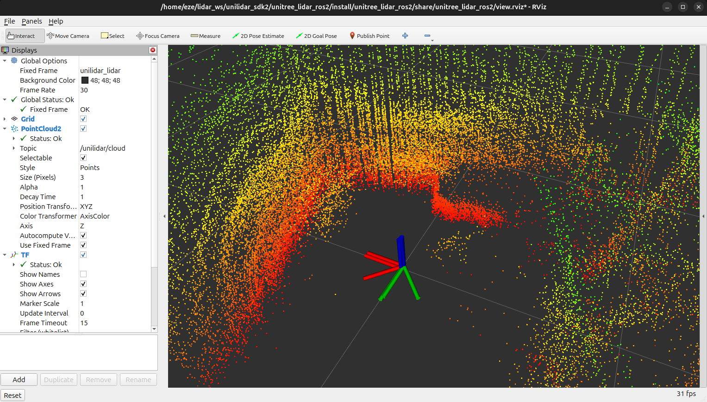

# Paso 03 — Driver ROS 2 del LiDAR y visualización en RViz

## Objetivo

Compilar y ejecutar el driver ROS 2 oficial del L2 (`unitree_lidar_ros2`) en **ROS 2 Jazzy**,
verificar que publica la nube de puntos y la IMU, y verlas en **RViz**.

Unitree verificó este driver solo en Ubuntu 20.04 + ROS 2 Foxy. En este proyecto se comprobó que
**compila y funciona sin cambios en Ubuntu 24.04 + Jazzy** (2026-11-12).

## Requisitos

- Paso 00 completo (ROS 2 Jazzy, `ros-jazzy-pcl-ros`, `ros-jazzy-pcl-conversions`, `libpcl-dev`,
  `libeigen3-dev`, `rosdep`).
- Paso 01 completo: SDK clonado en `~/lidar_ws/unilidar_sdk2` y sensor transmitiendo por Ethernet.
- Para usar USB: paso 02 (sensor en modo serie).

> **Nodo, tópico y mensaje.** En ROS 2, un **nodo** es un programa (por ejemplo, el driver del
> LiDAR). Los nodos publican **mensajes** en **tópicos** con nombre. El driver del L2 publica la
> nube de puntos en `/unilidar/cloud` (mensaje `sensor_msgs/PointCloud2`) y la IMU en
> `/unilidar/imu` (mensaje `sensor_msgs/Imu`). Cualquier otro programa (RViz, el grabador de datos,
> el SLAM) se suscribe a esos tópicos.

> **Marcos de referencia (frames).** Cada dato dice en qué sistema de coordenadas está expresado:
> la nube en `unilidar_lidar` y la IMU en `unilidar_imu`. ROS 2 publica las relaciones entre marcos
> en el tópico `/tf`.

## 1. Compilar el driver

El paquete está dentro del SDK. **Hay que compilarlo en su carpeta original y no moverlo**: su
`CMakeLists.txt` busca la librería del SDK con una ruta relativa
(`../../../unitree_lidar_sdk/lib/<arquitectura>`).

```bash
source /opt/ros/jazzy/setup.bash
cd ~/lidar_ws/unilidar_sdk2/unitree_lidar_ros2

# Comprueba que estén instaladas todas las dependencias del paquete
rosdep check --from-paths src --ignore-src

colcon build
```

> El README del SDK dice `cd unilidar_sdk/unitree_lidar_ros2`: la carpeta real se llama
> `unilidar_sdk2`.

**Salida esperada:**

```text
All system dependencies have been satisfied
Starting >>> unitree_lidar_ros2
--- stderr: unitree_lidar_ros2
CMake Warning (dev) at /usr/lib/x86_64-linux-gnu/cmake/pcl/Modules/FindFLANN.cmake:45 (find_package):
  Policy CMP0144 is not set: ...
CMake Warning (dev) at CMakeLists.txt:23 (find_package):
  Policy CMP0074 is not set: ...
---
Finished <<< unitree_lidar_ros2 [25.5s]
Summary: 1 package finished [25.8s]
```

Los dos avisos de CMake vienen de los módulos de PCL y **no afectan**. El compilador no da
advertencias.

## 2. Lanzar el driver

### 2.1 Con el launch del proyecto (recomendado)

El proyecto tiene su propio archivo de lanzamiento,
`config/unitree_lidar_ros2/l2_driver.launch.py`, basado en el original del SDK. Sus ventajas:

- El argumento **`modo:=ethernet`** o **`modo:=usb`** configura juntos `initialize_type` y
  `work_mode`. Con el launch original, usar USB sin cambiar también `work_mode` devuelve el sensor
  a modo Ethernet y se corta la conexión (el driver ejecuta `setLidarWorkMode(work_mode)` al
  arrancar).
- Argumentos para las IPs y el puerto serie, sin editar archivos.
- **`rviz:=false`** para no abrir RViz cuando se trabaja por SSH.

Como el driver es un proceso largo, conviene correrlo dentro de **tmux**: si se corta la conexión
SSH o se cierra la terminal, sigue funcionando.

```bash
tmux new -s lidar                      # abre una sesión llamada "lidar"

source /opt/ros/jazzy/setup.bash
source ~/lidar_ws/unilidar_sdk2/unitree_lidar_ros2/install/setup.bash
cd ~/Documentos/LiDAR-RobotHumanoide
ros2 launch config/unitree_lidar_ros2/l2_driver.launch.py modo:=ethernet rviz:=false
```

- Salir de la sesión dejándola en marcha: **Ctrl+b**, soltar, y después **d**.
- Volver a la sesión: `tmux attach -t lidar`.
- Detener el driver: dentro de la sesión, **Ctrl+C**. Si se lanzó en otra terminal y no se sabe
  en cuál: `pkill -INT -f l2_driver.launch.py` (equivale a Ctrl+C).

**Salida esperada:**

```text
[INFO] [unitree_lidar_ros2_node-1]: process started with pid [8192]
[unitree_lidar_ros2_node-1] initialize_type_ = 2
[unitree_lidar_ros2_node-1] [UDPHandler] create udp socket success.
[unitree_lidar_ros2_node-1] [UDPHandler] bind udp port success. port 6201.
[unitree_lidar_ros2_node-1] [UDPHandler] set udp recv timeout success. 1 sec.
```

Otras variantes:

```bash
# Con RViz (en una terminal del escritorio, ver el punto 4)
ros2 launch config/unitree_lidar_ros2/l2_driver.launch.py modo:=ethernet
# Si se cambió la red del sensor
ros2 launch config/unitree_lidar_ros2/l2_driver.launch.py modo:=ethernet \
    lidar_ip:=192.168.10.62 local_ip:=192.168.10.2
# Por USB (requiere el paso 02) — A VERIFICAR
ros2 launch config/unitree_lidar_ros2/l2_driver.launch.py modo:=usb rviz:=false
```

### 2.2 Con el launch original del SDK

Funciona solo por Ethernet con la red de fábrica, y siempre abre RViz:

```bash
ros2 launch unitree_lidar_ros2 launch.py
```

## 3. Verificar los tópicos

En otra terminal (con `source /opt/ros/jazzy/setup.bash`):

```bash
ros2 topic list
ros2 topic hz /unilidar/cloud
ros2 topic hz /unilidar/imu
```

**Salida obtenida** (Ethernet, 2026-11-12):

```text
/parameter_events
/rosout
/tf
/unilidar/cloud
/unilidar/imu
```

| Tópico | Frecuencia medida | Contenido |
|---|---|---|
| `/unilidar/cloud` | **12,0 Hz** (período 83–84 ms) | `PointCloud2`, frame `unilidar_lidar`, ~4.400–5.100 puntos por mensaje |
| `/unilidar/imu` | **251 Hz** | `Imu`, frame `unilidar_imu` |
| `/tf` | — | `unilidar_imu_initial` → `unilidar_imu` (orientación estimada por la IMU) |

Campos de cada punto de la nube (los que necesita el SLAM Point-LIO):

```bash
ros2 topic echo --once /unilidar/cloud --field fields
```

| Campo | Tipo | Significado |
|---|---|---|
| `x`, `y`, `z` | float32 | Posición en metros |
| `intensity` | float32 | Reflectividad |
| `ring` | uint16 | Anillo (0 a 17) |
| `time` | float32 | Tiempo relativo del punto dentro del mensaje, en segundos |

## 4. Ver la nube en RViz

RViz es una ventana gráfica: se abre en una **terminal del escritorio de Ubuntu** (o por escritorio
remoto), no por SSH. Con el driver ya corriendo:

```bash
source ~/lidar_ws/unilidar_sdk2/unitree_lidar_ros2/install/setup.bash
rviz2 -d ~/lidar_ws/unilidar_sdk2/unitree_lidar_ros2/install/unitree_lidar_ros2/share/unitree_lidar_ros2/view.rviz
```

La configuración `view.rviz` del SDK ya trae el marco fijo `unilidar_lidar`, la nube de
`/unilidar/cloud` coloreada por altura y los ejes de `/tf`.



**Resultado esperado:** se reconocen las paredes, el piso y los objetos alrededor del sensor. Los
ejes de colores marcan la orientación de la IMU (rojo X, verde Y, azul Z).

> **¿Qué es una nube de puntos?** Es el conjunto de puntos medidos por el sensor, cada uno con sus
> coordenadas X, Y, Z. El L2 mide de abajo hacia arriba y alrededor (semiesfera), así que en RViz se
> ve una "cúpula" de puntos sobre las superficies que rodean al sensor. Los colores solo indican la
> altura.

## Verificación final

- [ ] `colcon build` termina con `1 package finished`.
- [ ] `ros2 topic hz /unilidar/cloud` da unos 12 Hz y `/unilidar/imu` unos 250 Hz.
- [ ] En RViz se reconoce el lugar.

## Problemas frecuentes

| Síntoma (error literal) | Causa | Solución |
|---|---|---|
| `rviz2: symbol lookup error: /snap/core20/current/lib/x86_64-linux-gnu/libpthread.so.0: undefined symbol: __libc_pthread_init, version GLIBC_PRIVATE` | RViz se lanzó desde la terminal integrada de **VS Code instalado como snap**, que agrega al entorno variables propias (`GTK_PATH`, `GTK_EXE_PREFIX`, `GIO_MODULE_DIR`, `LOCPATH`, etc.) | Abrir RViz desde la terminal de Ubuntu (verificado). Alternativa: `env -u GTK_PATH -u GTK_EXE_PREFIX -u GIO_MODULE_DIR -u GTK_IM_MODULE_FILE -u LOCPATH -u SNAP rviz2 ...` (A VERIFICAR) |
| `PackageNotFoundError: "package 'unitree_lidar_ros2' not found` | No se cargó el entorno del driver compilado | `source ~/lidar_ws/unilidar_sdk2/unitree_lidar_ros2/install/setup.bash` |
| El driver arranca pero los tópicos no reciben datos | Otro programa usa el puerto 6201 (ejemplo del SDK, `estado_lidar`, `verificar_udp_lidar.py`) o falla la red | Cerrar el otro programa; revisar el paso 01 |
| Error al compilar: no encuentra `libunilidar_sdk2.a` | Se movió el paquete fuera de `unilidar_sdk2/unitree_lidar_ros2` | Compilar en la carpeta original |
| Por USB, la conexión se corta al lanzar el driver | Se usó `initialize_type: 1` con `work_mode: 0` (el sensor volvió a Ethernet) | Usar el launch del proyecto con `modo:=usb` |
| RViz muestra `Fixed Frame [...] does not exist` | El marco fijo no coincide con el de la nube | Poner `unilidar_lidar` en *Global Options → Fixed Frame* |
