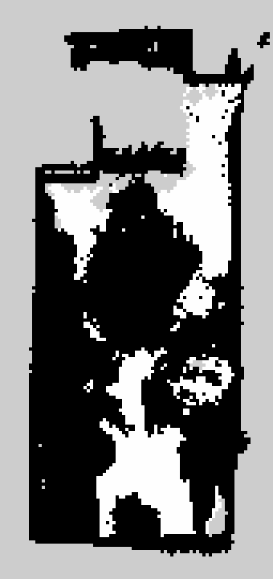

# Paso 07 — Productos del mapa: mapa 3D limpio y mapa 2D para Nav2

## Objetivo

Convertir el mapa 3D que genera Point-LIO (paso 05) en los dos productos que va a usar el robot:

1. **Mapa 3D limpio** (`mapa_limpio.pcd`): nivelado (piso horizontal y en z = 0), con las paredes
   alineadas con los ejes, sin puntos sueltos y mucho más liviano.
2. **Mapa 2D de ocupación** (`mapa_2d.pgm` + `mapa_2d.yaml`): la "planta" del lugar en el formato
   estándar de **Nav2**, el sistema de navegación de ROS 2. Es el mapa que el robot va a cargar
   para ubicarse y planificar sus recorridos.

No hace falta el sensor: se trabaja sobre un mapa ya generado.

> **¿Qué es un mapa de ocupación?** Una grilla vista desde arriba, como una hoja cuadriculada,
> donde cada celda (de 5 cm de lado) dice si ese lugar está **ocupado** (pared, mueble: el robot
> no puede pasar), **libre** (piso despejado) o **desconocido** (no se vio). Se guarda como una
> imagen en escala de grises (negro, blanco y gris) más un archivo de texto con la escala y la
> posición.

> **¿Por qué nivelar?** El mapa de Point-LIO queda orientado según cómo estaba el sensor al
> empezar a grabar, y puede quedar levemente inclinado (paso 05, punto 6). Para hacer la planta hay
> que "cortar" el mapa a ciertas alturas sobre el piso, y eso solo funciona si el piso está
> perfectamente horizontal y a una altura conocida (z = 0).

## Requisitos

- Un mapa generado con el paso 05 o 06: una carpeta `mapas/<fecha>_<nombre>/` con `mapa.pcd` (y,
  si existe, `trayectoria.csv`).
- Para que el mapa 2D salga bien, el mapa tiene que **ver el piso**: grabación con el sensor
  vertical o inclinado (paso 06, "Cómo llevar el sensor").
- Paquetes (si no se instalaron en el paso 00):

  ```bash
  sudo apt install -y python3-numpy python3-scipy python3-pil \
      ros-jazzy-nav2-map-server ros-jazzy-nav2-util
  ```

  | Paquete | Para qué |
  |---|---|
  | `python3-numpy`, `python3-scipy` | Cálculos sobre la nube de puntos (vecinos, planos, grillas) |
  | `python3-pil` | Guardar una copia PNG del mapa 2D (opcional) |
  | `ros-jazzy-nav2-map-server` | Cargar el mapa 2D como lo hace Nav2 (verificación) |
  | `ros-jazzy-nav2-util` | `lifecycle_bringup`, que activa el servidor de mapas |

Todos los comandos se ejecutan desde la carpeta del repositorio:

```bash
cd ~/Documentos/LiDAR-RobotHumanoide
```

## 1. Mapa 3D limpio

```bash
./scripts/mapas/limpiar_mapa.py mapas/<carpeta_del_mapa>
```

### 1.1 Qué hace, paso por paso

| Paso | Qué hace | Parámetro (valor por defecto) |
|---|---|---|
| 1. Reducción de densidad | Divide el espacio en cubos de 3 cm y deja **un punto por cubo** (el promedio). Point-LIO repite muchas veces los mismos puntos: el archivo baja de decenas de MB a pocos MB sin perder forma | `--voxel 0.03` |
| 2. Puntos sueltos | Para cada punto calcula la distancia media a sus 10 vecinos más cercanos; quita los que están mucho más lejos que el promedio (más de 2 desvíos): ruido y reflejos aislados | `--vecinos 10`, `--sigma 2.0` |
| 3. Nivelación | Busca los planos casi horizontales (RANSAC, hasta 30° de inclinación) y toma el **más bajo como piso**. Rota la nube para que quede horizontal y la desplaza para que el piso quede en **z = 0**. Después hace una segunda pasada con todos los puntos de la franja del piso (±5 cm) para afinar | `--referencia piso` |
| 4. Alineación de paredes | Busca la pared principal (plano vertical) y gira el mapa alrededor del eje vertical para que quede paralela al eje x o al y | `--sin-alinear` la desactiva |
| 5. Guardado | Guarda la nube y la misma transformación aplicada a la trayectoria | — |

**Control de seguridad del paso 3:** el piso es la superficie más baja del lugar, así que casi no
puede haber puntos por debajo. Si el plano más bajo tiene más del 5 % de los puntos debajo, no es
el piso (por ejemplo, una mesa, porque el sensor no vio el piso): el script **no nivela** y lo
avisa, en lugar de dejar un mapa mal nivelado.

> **RANSAC** (*RANdom SAmple Consensus*) es un método para encontrar un plano en una nube con
> ruido: elige 3 puntos al azar, arma el plano que pasa por ellos y cuenta cuántos puntos quedan
> cerca. Lo repite cientos de veces y se queda con el plano que más puntos explica.

### 1.2 Salida obtenida

Habitación grabada con el sensor vertical (`mapas/2026-11-12_1445_habitacion_vertical_rapido`):

```text
1. Reducción a celdas de 3 cm: 1.102.546 -> 350.797 puntos
2. Puntos sueltos quitados: 11.446 (vecinos=10, sigma=2.0) -> quedan 339.351
   plano horizontal a z =   1.96 m, inclinación  1.3°,  8.9 % de los puntos
   plano horizontal a z =   1.86 m, inclinación  3.8°,  3.8 % de los puntos
   plano horizontal a z =  -0.89 m, inclinación  1.9°,  4.7 % de los puntos
   plano horizontal a z =   0.00 m, inclinación  0.6°,  3.4 % de los puntos
   plano horizontal a z =   1.90 m, inclinación  1.9°,  2.9 % de los puntos
3. Nivelación con el piso: inclinación corregida 1.9°; piso llevado a z = 0 (desplazamiento +0.88 m)
   Refinamiento con la franja del piso (12.395 puntos): 0.35° adicionales
4. Alineación de paredes: giro de +40.0° alrededor del eje vertical
5. Guardado .../mapa_limpio.pcd: 339.351 puntos, 5.4 MB
   trayectoria_limpia.csv: trayectoria con la misma transformación
   Extensión útil (1 %-99 %): x 3.21 m, y 7.88 m, z -0.06 a 2.85 m
```

Cómo leerla:

- Los planos a z ≈ 1,9 m son el **techo** (visto en partes); el de −0,89 m es el **piso**; el de
  0,00 m es la **mesa** donde se apoyó el sensor al empezar (el origen del mapa es la posición
  inicial del sensor, por eso la mesa queda en 0 y el piso 0,88 m más abajo).
- Se corrigieron 1,9° + 0,35° de inclinación y el piso quedó en z = 0.
- Resultado: habitación de unos 3,2 × 7,9 m y 2,85 m de alto; el archivo pasó de 34 MB a 5,4 MB.

### 1.3 Archivos que genera (en la carpeta del mapa)

| Archivo | Contenido |
|---|---|
| `mapa_limpio.pcd` | La nube limpia (campos `x y z intensity`) |
| `trayectoria_limpia.csv` | La trayectoria del sensor en las coordenadas del mapa limpio |
| `transformacion.txt` | La matriz 4 × 4 aplicada: `punto_limpio = T × punto_original`. Relaciona las coordenadas de Point-LIO con las del mapa limpio; se va a necesitar para usar el mapa en el robot |
| `limpieza.txt` | La misma salida de la terminal, como registro |

### 1.4 Verificación

Con números (la inclinación de piso y techo tiene que ser de 1° o menos):

```bash
./scripts/mapas/analizar_mapa.py mapas/<carpeta>/mapa_limpio.pcd mapas/<carpeta>/trayectoria_limpia.csv
```

```text
  Planos principales (muestra de 40000 puntos):
    plano horizontal a z =  2.80 m: inclinación  0.3° (11 % de los puntos)
    plano horizontal a z =  0.00 m: inclinación  0.8° (4 % de los puntos)
    pared principal: girada 89.6° respecto del eje X en planta (equivale a  -0.4°; ...)
```

Antes de limpiar, el mismo mapa daba 1,9°. Ahora el piso está en z = 0,00 m y la pared principal,
alineada con los ejes (−0,4°).

Visualmente (terminal del escritorio):

```bash
./scripts/mapas/ver_mapa.sh mapas/<carpeta>/mapa_limpio.pcd mapas/<carpeta>/trayectoria_limpia.csv
```

El piso debe verse paralelo a la grilla de RViz y las paredes, paralelas a sus líneas.

### 1.5 ¿Sirve para cualquier mapa?

Sí: para cualquier archivo `.pcd` con campos `x`, `y`, `z` (de Point-LIO o de otro SLAM), de
cualquier lugar y con el sensor en cualquier orientación. Acepta la carpeta de un mapa o un `.pcd`
suelto (`--salida <carpeta>` indica dónde guardar). La única condición es que **se vea el piso**
para nivelar. Si no se ve (por ejemplo, grabación con el sensor horizontal apoyado en el piso),
el script lo detecta:

```text
3. Nivelación: NO se hace. El plano más bajo (z = 0.42 m) tiene el 13 % de los puntos por debajo: no es el piso (¿el mapa no ve el piso?).
   Probar con --referencia techo, o --sin-nivelar.
```

Opciones para esos casos:

| Opción | Efecto |
|---|---|
| `--referencia techo` | Nivela usando el techo (el plano horizontal más alto). No mueve la altura (z = 0 queda donde estaba el sensor) |
| `--sin-nivelar` | No nivela |
| `--sin-alinear` | No gira el mapa en planta |
| `--voxel 0.05` | Celdas más grandes: archivo más liviano, menos detalle |

Ver todas las opciones con `./scripts/mapas/limpiar_mapa.py --ayuda`.

## 2. Mapa 2D de ocupación

```bash
./scripts/mapas/generar_mapa_2d.py mapas/<carpeta_del_mapa>
```

Usa `mapa_limpio.pcd` de la carpeta: hay que correr antes el punto 1.

### 2.1 Qué hace, paso por paso

1. Arma una grilla de celdas de **5 cm** que cubre el mapa (sin el 0,5 % de puntos más alejados)
   más un borde de 0,5 m.
2. **Celdas ocupadas:** las que tienen al menos 2 puntos dentro de la **franja de alturas** de
   0,10 m a 1,80 m sobre el piso. Es la franja donde el robot puede chocar: lo de más abajo (el
   piso, una alfombra) y lo de más arriba (el techo, una lámpara colgante alta) no es obstáculo.
3. **Celdas libres:** las que tienen puntos de piso (a menos de 5 cm de z = 0) y ningún obstáculo.
   También se marcan libres unos 20 cm alrededor de la **trayectoria** de quien llevaba el sensor
   (por ahí se caminó, así que hay lugar). Después se rellenan huecos chicos del piso libre
   (operación morfológica de "cierre", 2 iteraciones).
4. **Celdas desconocidas:** el resto.
5. Guarda la imagen y sus metadatos.

| Parámetro | Defecto | Significado |
|---|---|---|
| `--resolucion` | 0.05 | Tamaño de celda en metros |
| `--altura-min` | 0.10 | Altura mínima de un obstáculo sobre el piso (m) |
| `--altura-max` | 1.80 | Altura máxima de un obstáculo (m). Debe ser **al menos la altura del robot**: lo que esté más alto no lo puede chocar. Altura del R1 con el sensor montado: **A VERIFICAR** |
| `--piso` | 0.05 | Tolerancia para considerar un punto como piso (m) |
| `--min-puntos` | 2 | Puntos necesarios para marcar una celda como ocupada (filtra ruido) |
| `--cerrar` | 2 | Iteraciones de relleno de huecos del piso libre (0 = sin relleno) |
| `--margen` | 0.5 | Borde agregado alrededor del mapa (m) |

### 2.2 Salida obtenida

```text
Mapa 3D: mapas/2026-11-12_1445_habitacion_vertical_rapido/mapa_limpio.pcd
Grilla: 85 x 180 celdas de 5 cm = 4.25 x 9.00 m
Origen (esquina inferior izquierda): x = -2.497 m, y = -3.800 m
Franja de obstáculos: 0.10 a 1.80 m sobre el piso
Celdas: ocupadas 41.7 %, libres 14.7 %, desconocidas 43.6 %
Trayectoria usada como zona libre: sí
Guardado: .../mapa_2d.pgm, .../mapa_2d.yaml y mapa_2d.png
```



Se ven el contorno de la habitación (unos 3,2 × 7,9 m), la zona libre por donde se caminó y, en la
parte superior, parte del ambiente contiguo visto por una puerta. Las manchas negras grandes dentro
de la habitación son **muebles**: el análisis por alturas mostró unos 5 m² de superficies entre
0,7 y 1,0 m (mesas y escritorios; la mesa donde se apoyó el sensor está a 0,88 m) y 3,7 m² que
llegan a 1,8 m (paredes y muebles altos). Para un robot, una mesa es un obstáculo: está bien que
figure ocupada. Debajo de las mesas el mapa queda "desconocido" u "ocupado", porque el sensor no
ve a través de ellas.

### 2.3 Archivos que genera

`mapa_2d.yaml` (ejemplo real):

```yaml
# Mapa 2D de ocupación para nav2_map_server (generar_mapa_2d.py)
# Franja de obstáculos: 0.10 a 1.80 m sobre el piso; min_puntos=2; piso ±0.05 m
image: mapa_2d.pgm
mode: trinary
resolution: 0.05
origin: [-2.497, -3.800, 0.0]
negate: 0
occupied_thresh: 0.65
free_thresh: 0.196
```

| Campo | Significado |
|---|---|
| `image` | La imagen del mapa (`.pgm`, escala de grises de 8 bits) |
| `mode: trinary` | Cada celda es ocupada, libre o desconocida (sin valores intermedios) |
| `resolution` | Metros por píxel (0,05 = 5 cm) |
| `origin` | Posición (x, y, giro) del **píxel inferior izquierdo** en el marco `map` |
| `negate: 0` | Negro = ocupado, blanco = libre |
| `occupied_thresh`, `free_thresh` | Umbrales con los que Nav2 interpreta cada píxel |

Valores de los píxeles y cómo los interpreta Nav2, que calcula `p = (255 − valor) / 255`:

| Píxel | `p` | Resultado en Nav2 |
|---|---|---|
| 0 (negro) | 1,0 > 0,65 | Ocupada (100) |
| 254 (blanco) | 0,004 < 0,196 | Libre (0) |
| 205 (gris) | 0,19608: no es menor que 0,196 ni mayor que 0,65 | Desconocida (−1) |

> **Cuidado con `free_thresh`:** con un valor mayor que 0,196 (por ejemplo 0,25), el gris pasa a
> ser **libre** y el robot creería que puede ir por zonas que nunca se vieron. 0,196 es el valor
> estándar de ROS para este formato.

`mapa_2d.png` es la misma imagen en PNG, para verla con cualquier visor o usarla en documentos.

## 3. Verificar el mapa 2D con Nav2

### 3.1 Con el script

Desde una terminal del escritorio:

```bash
./scripts/mapas/ver_mapa_2d.sh mapas/<carpeta_del_mapa>
```

Carga el mapa con `nav2_map_server` (el mismo programa que va a usar el robot), lo activa y lo
muestra en RViz visto desde arriba (`config/rviz/ver_mapa_2d.rviz`). Si se ve igual que
`mapa_2d.png`, el formato es correcto para Nav2. Al cerrar RViz se detiene todo.

### 3.2 A mano (lo mismo que hace el script)

```bash
# Terminal 1: servidor de mapas de Nav2 (la ruta del .yaml tiene que ser completa)
source /opt/ros/jazzy/setup.bash
ros2 run nav2_map_server map_server --ros-args \
    -p yaml_filename:=$HOME/Documentos/LiDAR-RobotHumanoide/mapas/<carpeta>/mapa_2d.yaml

# Terminal 2: activarlo (configure + activate) y publicar el marco "map"
source /opt/ros/jazzy/setup.bash
ros2 run nav2_util lifecycle_bringup map_server
ros2 run tf2_ros static_transform_publisher --frame-id map --child-frame-id mapa_origen

# Terminal 3: RViz
source /opt/ros/jazzy/setup.bash
rviz2 -d ~/Documentos/LiDAR-RobotHumanoide/config/rviz/ver_mapa_2d.rviz
```

> **¿Por qué hay que "activarlo"?** Los nodos de Nav2 son *lifecycle nodes*: arrancan inactivos y
> solo publican después de pasar por los estados *configure* y *activate*. `lifecycle_bringup`
> hace esas dos transiciones. Sin eso, RViz muestra "No map received".

La terminal 1 muestra:

```text
[INFO] [...] [map_io]: Loading yaml file: .../mapa_2d.yaml
[INFO] [...] [map_io]: Loading image_file: .../mapa_2d.pgm
[INFO] [...] [map_io]: Read map .../mapa_2d.pgm: 85 X 180 map @ 0.05 m/cell
```

### 3.3 Comprobar cómo lo interpreta Nav2

Con el servidor de mapas cargado y activado (punto 3.1 o 3.2), en otra terminal:

```bash
source /opt/ros/jazzy/setup.bash
./scripts/mapas/verificar_mapa_2d.py
```

```text
Mapa en /map: 85 x 180 celdas de 5 cm (4.25 x 9.00 m), origen (-2.497, -3.800), marco 'map'
Nav2 recibe: ocupadas (100) 41.7 %, libres (0) 14.7 %, desconocidas (-1) 43.6 %, otros valores 0.0 %
```

Los porcentajes tienen que ser **iguales** a los de `generar_mapa_2d.py` (punto 2.2) y "otros
valores" tiene que dar 0 %. Si no, los umbrales del `.yaml` están mal.

## 4. Qué se sube a git

| Archivo | ¿En git? |
|---|---|
| `mapa_limpio.pcd` | No (los `.pcd` están en `.gitignore`); se regenera con el punto 1 |
| `trayectoria_limpia.csv`, `transformacion.txt`, `limpieza.txt` | Sí |
| `mapa_2d.pgm`, `mapa_2d.yaml`, `mapa_2d.png` | Sí (pesan pocos kB) |

## 5. Pendiente (opcional)

- **Gemelo digital para Gazebo** (malla 3D de la habitación para simulación): requiere Open3D u
  otra herramienta de reconstrucción de mallas. No es necesario para el objetivo de corto plazo.
- **Altura del robot** para `--altura-max`, cuando se defina el montaje del sensor en el R1.

## Verificación final

- [ ] `limpiar_mapa.py` nivela el mapa: `analizar_mapa.py` sobre `mapa_limpio.pcd` da 1° o menos.
- [ ] `generar_mapa_2d.py` genera `mapa_2d.pgm`, `mapa_2d.yaml` y `mapa_2d.png`.
- [ ] `ver_mapa_2d.sh` muestra en RViz el mismo mapa que `mapa_2d.png`.
- [ ] `verificar_mapa_2d.py` da los mismos porcentajes que `generar_mapa_2d.py`.

## Problemas frecuentes

| Síntoma | Causa | Solución |
|---|---|---|
| `ERROR: no existe .../mapa_limpio.pcd. Ejecutar antes: ./scripts/mapas/limpiar_mapa.py ...` | Se generó el 2D sin limpiar antes | Correr el punto 1 |
| `3. Nivelación: NO se hace. El plano más bajo ... no es el piso` | El mapa no ve el piso (sensor horizontal) | `--referencia techo`; para el mapa 2D, grabar de nuevo con el sensor vertical o inclinado |
| El mapa 2D sale casi todo gris (desconocido) | No se ve el piso, o el mapa no está nivelado | Revisar `limpieza.txt` (¿se niveló?) y la orientación del sensor al grabar |
| El mapa 2D sale casi todo negro, incluido el techo | El mapa no estaba nivelado o el piso no quedó en z = 0, y la franja de alturas incluyó el techo | Volver a correr `limpiar_mapa.py` y revisar su salida |
| Las paredes aparecen dobles o corridas en el mapa 2D | El mapa 3D ya las tenía (problema del SLAM) | Repetir la grabación (paso 06) |
| RViz: "No map received" | El servidor de mapas no se activó | `ros2 run nav2_util lifecycle_bringup map_server` |
| `verificar_mapa_2d.py`: "otros valores" distinto de 0 % o porcentajes distintos | Umbrales del `.yaml` modificados a mano | Usar `occupied_thresh: 0.65` y `free_thresh: 0.196` |
